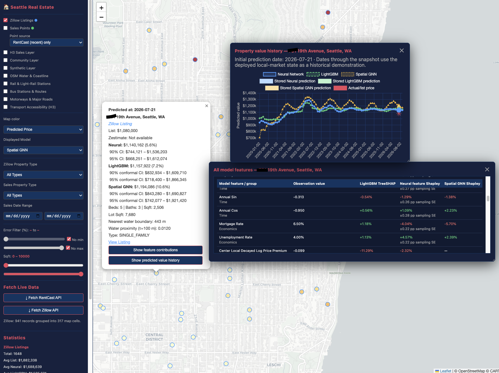

# Spatial Real Estate Price Prediction

This project trains and serves a spatial house-price model for King County,
Washington. The primary model is a monthly H3 GraphSAGE network whose learned
market embeddings are pooled at the property's exact coordinates and combined
with property, time, and economic features to estimate sale price.

The application also serves a Transformer model and LightGBM for comparison.
Its map supports observed listings, draggable synthetic properties, model
explanations, and direct comparison of SpatialGNN or Transformer errors against
LightGBM.



## SpatialGNN

The current deployed SpatialGNN uses architecture version 3. It replaces a
single fixed-cell lookup with continuous spatial pooling, so a prediction can
change as a synthetic property is dragged within or across H3 cells.

### Architecture

- **Causal monthly graph:** each snapshot contains one node per observed H3
  level-8 cell. Node features are calculated only from sales before the
  snapshot month, preventing future-sale leakage.
- **Spatial message passing:** observed cells are connected to their H3
  one-ring neighbours. Two GraphSAGE layers give each node a two-hop spatial
  receptive field. The deployed model enables graph LayerNorm and residual
  connections.
- **Continuous coordinate pooling:** inference gathers eligible embeddings from
  nearby H3 cells and applies a compact Wendland C2 distance kernel. The
  deployed bundle searches three H3 rings within a 1.5 km radius. This avoids
  treating every coordinate in a cell as the same location.
- **Dated embeddings:** the graph produces a causal embedding for each
  cell-month. A prediction uses the snapshot appropriate for its observation
  date.
- **Price head:** the pooled spatial embedding is combined with property
  features, continuous date features, and dated mortgage and unemployment
  values, then passed through an MLP regression head.

The graph node state contains decayed local price premium, price dispersion,
sale volume, recency, and relative price trend. The price head additionally
uses living area, lot area, bedrooms, water proximity, linear and cyclical time
features, mortgage rate, and unemployment rate.

### Training

Install the Python package in editable mode, then train the GNN:

```bash
python3 -m pip install -e .
make train-gnn
```

To train with the spatial behavior used by the current Java bundle:

```bash
python3 main_train_gnn.py \
  --continuous-embedding-pooling \
  --spatial-pool-radius-km 1.5 \
  --spatial-pool-h3-ring 3 \
  --graph-layer-norm \
  --graph-residual
```

Each run is written beneath `outputs/gnn/<timestamp>/` and includes the PyTorch
checkpoint, graph state, scalers, metrics, validation predictions, and a
`run_manifest.json`. The manifest records the architecture, training
configuration, data and split hashes, Git state, and final metrics.

### Java deployment

Python computes the monthly graph embeddings before deployment. Java does not
reconstruct GraphSAGE at request time; it loads the exported embedding table,
performs the same coordinate pooling, and runs the compact price head in ONNX.

The SpatialGNN deployment consists of:

- `gnn_price_head.onnx`
- `gnn_scalers.json`
- `gnn_metadata.json`
- `gnn_monthly_embeddings.bin.gz`

Train a new GNN when needed, then build and atomically install a complete Java
model bundle:

```bash
make train-gnn
make retrain-deploy
```

`make retrain-deploy` retrains the Transformer and LightGBM models and deploys
them with the latest trained GNN. Export checks ONNX parity and the shared
feature contract before replacing the installed bundle.

For a requested date after the final exported graph snapshot, Java uses the
latest available causal embedding. This avoids look-ahead but the spatial state
will become stale until another GNN is trained and deployed.

## Model comparison and interpretation

The Java map exposes the three deployed estimates in this order:
SpatialGNN, Transformer, and LightGBM.

- **Prediction error shift** compares absolute percentage error with LightGBM:
  `|LightGBM error| - |selected model error|`. Positive values mean the selected
  model is closer to the listing price; negative values mean LightGBM is
  closer.
- **Bias shift** compares signed percentage errors:
  `selected model error - LightGBM error`. Its sign shows whether the selected
  model moves toward overestimation or underestimation relative to LightGBM.
- **Synthetic properties** can be dragged to test coordinate sensitivity. The
  SpatialGNN estimate is recalculated at the new latitude and longitude.
- **Feature contributions** explain the property, time, and economic inputs
  while treating the learned spatial embedding as one model component. The
  listing sale price remains visible as context.

The comparison models serve different purposes:

- **Transformer:** a tabular attention model with a learned community embedding,
  numeric feature tokens, a `[CLS]` aggregation token, and an MLP price head.
- **LightGBM:** a boosted-tree comparator trained on the corresponding prepared
  inputs and chronological holdout.

## Data and feature sources

- **Historical residential sales:** [King County Sales, version 8](https://www.kaggle.com/datasets/andykrause/kingcountysales/data),
  covering single-family sales from 1999 through 2025.
- **Recent property data:** RentCast properties API.
- **Listing data:** Zillow results obtained through HasData.
- **Economic indicators:** Federal Reserve Economic Data series
  `MORTGAGE30US` and `UNRATE`.
- **Spatial indexing:** H3 cells at resolution 8.
- **Water proximity:** distance to retained OpenStreetMap water boundaries,
  transformed for modeling as `exp(-distance_to_water_m / 100)`.

The canonical water geometry is `data/osm/king_county_water.geojson`. Rebuild it
from a local Washington PBF with:

```bash
python3 scripts/extract_osm_water.py
```

The browser also provides optional rail, transit, and major-road overlays.
Rebuild their clipped GeoJSON artifacts with:

```bash
make osm-transport
```

## Running the project

Run the test suite and start Quarkus in development mode:

```bash
make test
make java-dev
```

The web application is served on port 8080. See the
[Java application guide](java-app/house-price-app/README.md) for ingestion,
prediction endpoints, artifact validation, and frontend behavior.

## GitHub Codespaces

The `.devcontainer` configuration provides Python 3.11, Java 21, the pinned
Python environment, warmed Maven dependencies, and a private forwarded Quarkus
port.

Configure `HF_TOKEN` as a Codespaces secret to enable the agent's Hugging Face
Inference Provider calls. Configure `CARTO_API_KEY` for the application
basemap. `RENTCAST_API_KEY` and `ZILLOW_API_KEY` are optional secrets for their
explicit ingestion actions. Secret values are injected as environment
variables and must not be committed to the repository.

After Codespaces setup completes:

```bash
make test
make java-dev
```

Port 8080 appears as **Quarkus house-price app** in the Ports panel. See the
[devcontainer guide](.devcontainer/README.md) for setup boundaries and secret
configuration.
